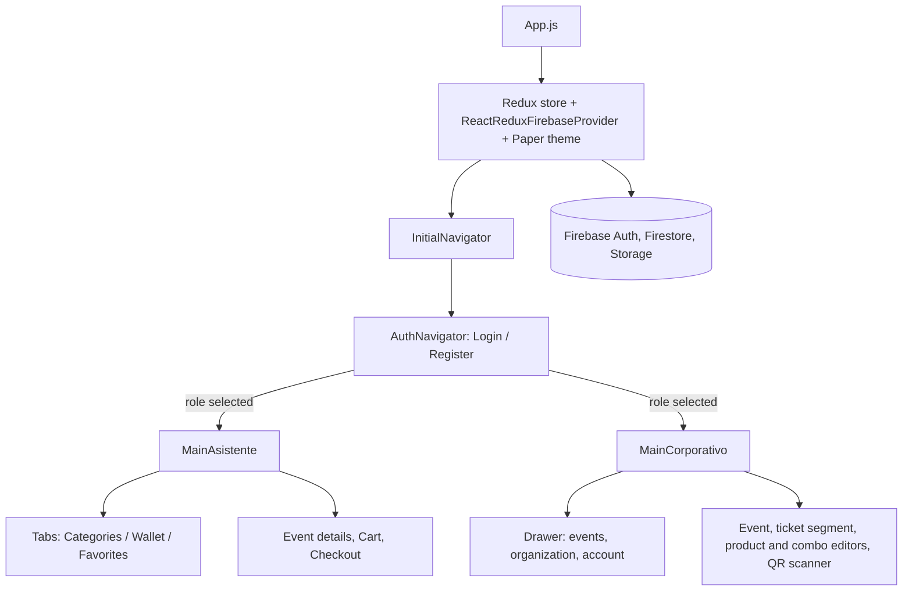

# Festival Fever

Festival Fever is an event discovery, ticketing and management mobile app for organizing and attending cultural events. Attendees browse events by category, buy tickets, products and combos from a built-in wallet, and enter with a QR code. Organizers and sellers manage events, inventory and staff from the same app, under a role selected at login.

It was the final project of the Information Systems Engineering degree at UTN Santa Fe (thesis, 2021-2023), scoped as an MVP with three modes: attendee, organizer and seller.

> **Status.** This is an archived snapshot that targets Expo SDK 41 and React Native 0.63 (bare workflow; the native project in the repository is Android). The original Firebase backend is not provisioned, so running the app requires your own Firebase project. See [Running it](#running-it).

## Features

### Attendee (`src/pages/asistente`)

- **Categories:** a category grid with an "all categories" entry, and a list or gallery view of the events in each category.
- **Search:** free-text search over event names.
- **Event details:** a landing page with date, place, a full-screen zoomable event image, contact data and the purchasable items split into Tickets, Combos and Products.
- **Cart and checkout:** item selection, a cart, and a checkout that shows the balance after the operation and blocks the purchase when funds are insufficient.
- **Wallet:** balance, adding funds, a transaction history and the list of orders.
- **QR tickets:** each active order item can be shown as a QR code (`react-qr-code`) that an organizer or seller scans at the entrance.
- **Favorites:** events can be starred and are listed in their own tab.
- **Maps:** events carry map coordinates; a full-screen map (`react-native-maps`) shows the venue.

### Organizer (`src/pages/corporativo`, role `userTypeId === 2`)

- **Events:** list, create and edit events (name, category, location picked on a map, contact data, dates, photo, active flag).
- **Ticket segments:** create and edit ticket types per event, with price and stock.
- **Products and combos:** create and edit sellable products and combos per event. Products and ticket segments can be copied between events through a clipboard held in the store.
- **Organization users and roles:** list the users of the organization, add users and assign or revoke roles.
- **QR scanner:** scans attendee QR codes (`expo-barcode-scanner`) and marks the order item as redeemed.
- **Inactive events:** a separate list of events that are not active.
- Also available: personal information and a help and support screen.

### Seller (vendedor)

The seller uses the same shell as the organizer (`MainCorporativo`) with a reduced feature set. A seller can:

- see the list of events,
- open the QR scanner from the header,
- edit personal information.

A seller cannot create events (no add button) and does not get the Inactive Events, My Organization or Help & Support entries in the drawer; those are shown only for `userTypeId === 2`.

### Auth and localization

- **Auth:** email and password sign-in and registration through Firebase Auth, with a "remember session" option. The user profile lives in the `users` Firestore collection and holds a list of role ids. If an account has more than one role (attendee, organizer, seller), a role selector appears after login.
- **i18n:** Spanish and English (`src/assets/locales`). The locale is taken from the device, with English as the default and fallback. Validation messages from `yup` go through the same translations.

## Architecture

- **Navigation (React Navigation 6).** A root stack (`InitialNavigator`) holds three destinations: `AuthNavigator` (login and register), `MainAsistente` and `MainCorporativo`. After login the selected role decides which of the last two is shown.
  - `MainAsistente` is a stack: `HomeAsistente` (material bottom tabs: Categories, Wallet, Favorites), My Account, Search, Event Details (a nested stack with Cart and Checkout) and the full-screen map.
  - `MainCorporativo` is a stack whose home is a drawer (My Events, Inactive Events, My Organization, Personal Information, Help & Support), plus the QR scanner, the map picker and the edit screens for events, ticket segments, products and combos.
- **State.** Redux Toolkit configures the store with three slices of state: `firebase` (react-redux-firebase), `firestore` (redux-firestore) and `myStore`, a small slice with the session context (attendee role, selected role and roles, selected event and category, product and ticket clipboards). Screens subscribe to Firestore through `useFirestoreConnect` and read the results from `state.firestore.ordered`; writes go through the Firestore instance. The collections used are `users`, `roles`, `organizations`, `events`, `categories`, `ticketSegments`, `purchasables`, `combos` and `orders`.
- **Forms.** `react-hook-form` with `yup` resolvers. Schemas live in `src/schemas` (login, user registration, event info, ticket segment, product, combo).
- **i18n.** `i18n-js` with `expo-localization`; `yup` error keys are mapped to translated messages.
- **UI.** `react-native-paper` components with a shared theme and color constants in `src/assets`, and the Poppins font.



## Testing

End-to-end tests run with [Detox](https://wix.github.io/Detox/) 20 on Jest, against an Android emulator. There are 20 test cases in 7 suites (`e2e/`):

| File | Cases | Covers |
| --- | --- | --- |
| `login.test.js` | 5 | email format validation, wrong credentials, remembering the session (attendee and role selector), logout |
| `attendeeNavigation.test.js` | 2 | bottom tab navigation and header navigation |
| `categoryDetails.test.js` | 2 | entering a category and going back, gallery and list views |
| `eventDetails.test.js` | 2 | event page components and map navigation, the buy-items flow |
| `corporativo.test.js` | 2 | organizer drawer features, editing event info |
| `vendedor.test.js` | 1 | the seller's restricted feature set |
| `integration.test.js` | 6 | buying a ticket, a product and a combo as an attendee, then checking the sold quantities as an organizer |

Supporting files are `e2e/util.js` (credentials loader and a Firestore URL blacklist, so Detox does not wait on Firestore's long-lived connections) and `e2e/jest.config.js`.

The app code exposes `testID`s on interactive and verifiable elements (about 60 across 31 files in `src`), which the suites use as selectors.

The tests run against a real Firebase project and expect seeded data: the accounts below and an event in the "Música en Vivo" category. Credentials are never hard-coded; they come from environment variables, optionally loaded from a git-ignored `.env` file (copy `.env.example`):

| Variable | Account |
| --- | --- |
| `E2E_ATTENDEE_EMAIL`, `E2E_ATTENDEE_PASSWORD` | an attendee |
| `E2E_ORGANIZER_EMAIL`, `E2E_ORGANIZER_PASSWORD` | a user holding both an organizer and a seller role |

## Running it

The toolchain dates from 2021, so match it rather than using current versions.

**Prerequisites**

- Node 14 with npm 6 (the lockfile is `lockfileVersion` 1).
- JDK 8 or 11 and the Android SDK (platform 31, build tools 29.0.3). The Gradle wrapper is 6.8 with Android Gradle Plugin 4.1.0.
- An Android emulator. The Detox configuration expects an AVD named `Pixel_6_API_30`.
- A Firebase project with Authentication (email/password), Firestore and Storage, and a Google Maps API key for Android.

**Setup**

1. Install dependencies:

   ```sh
   npm ci
   ```

2. Copy `firebase.config.example.js` to `firebase.config.js` and fill in your web app values. The file is git-ignored and imported by `src/context/FirebaseConfig.js`; Metro cannot bundle the app without it.
3. Download `google-services.json` from the Firebase console into `android/app/` (`android/app/google-services.example.json` shows the shape). It is git-ignored and required by the `google-services` Gradle plugin.
4. Provide the Maps key as the `MAPS_API_KEY` Gradle property (`-PMAPS_API_KEY=...` or `~/.gradle/gradle.properties`) or as the `MAPS_API_KEY` environment variable. It is injected into `AndroidManifest.xml`.
5. Create the Firestore data the app reads: the collections listed under [Architecture](#architecture), including a `roles` document with `userTypeId: 1` for attendees and the `categories` documents.

**Run on Android**

```sh
npm start          # Metro bundler
npm run android    # builds and installs the debug app on a running emulator
```

`npm run ios` and `npm run web` are defined in `package.json`, but the repository contains only the Android native project.

**Run the Detox suites**

`package.json` defines no Detox scripts; use the CLI with the configurations from `.detoxrc.js` (`android.emu.debug` is the default, plus `android.emu.release`, and `android.att.debug` / `android.att.release` for an attached device):

```sh
npx detox build --configuration android.emu.debug
npx detox test  --configuration android.emu.debug
npx detox test  --configuration android.emu.debug e2e/login.test.js   # a single suite
```

The build command in `.detoxrc.js` calls `gradlew` as a Windows shell command. Debug builds need Metro running (`npm start`); port 8081 is reversed to the emulator.

## Project structure

```
.
├── App.js                      # i18n and Firebase bootstrap, providers, root navigator
├── index.js                    # Expo entry point
├── app.json                    # Expo config (name, package com.julipetric.festivalfever)
├── firebase.config.example.js  # Template for the git-ignored firebase.config.js
├── .env.example                # Template for the e2e credentials
├── .detoxrc.js                 # Detox apps, devices and configurations
├── e2e/                        # Detox + Jest suites and helpers
├── android/                    # Native Android project (Gradle, Detox test runner)
└── src/
    ├── assets/                 # Colors, theme, styles, images, Poppins font, locales (en, es)
    ├── context/                # Providers, Firebase config, splash/font gate, Intl polyfills
    ├── firebase/               # Auth helper (logout) and event form helper
    ├── mocks/                  # Static contact data
    ├── pages/
    │   ├── asistente/          # Attendee: categories, event, cart, checkout, wallet, favorites, search
    │   ├── corporativo/        # Organizer/seller: events, ticket segments, products, combos, organization, QR scanner
    │   ├── common/             # Auth screens, role selector, My Account, map, shared navigators
    │   └── components/         # Reusable form inputs, buttons, header, list items, filter bar
    ├── redux/                  # Store and the myStore slice
    ├── schemas/                # yup validation schemas
    └── utils.js
```

## Credits

Co-authored by Julian Petric and Laureano López ([@lopez96lau](https://github.com/lopez96lau)).

The font is Poppins, licensed under the SIL Open Font License 1.1 (see `src/assets/fonts/OFL.txt`).
